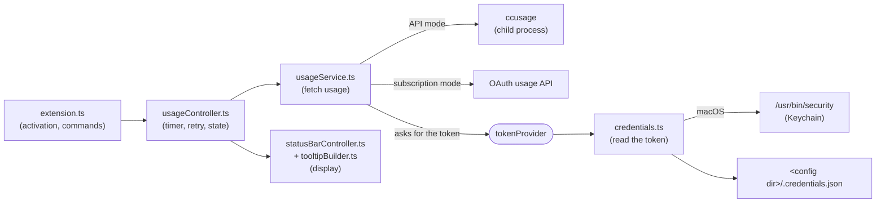

# Architecture

This document describes how the extension is put together and why. It stays at the level of modules and design decisions; read the code for the details.

## Overview

The extension shows Claude Code usage in the status bar. It has two display modes:

- **API mode**: runs [ccusage](https://github.com/ryoppippi/ccusage) and shows today's and this month's cost.
- **Subscription mode**: calls Anthropic's OAuth usage API with the token that Claude Code stores, and shows the 5-hour and 7-day utilization. ccusage is not needed.



## Modules

| Module | Responsibility |
|---|---|
| `extension.ts` | Activation. Creates the controller and registers the refresh command and the settings listener. |
| `configManager.ts` | Reads the extension's settings. |
| `usageController.ts` | Owns the refresh timer and the retry policy, and turns the result (or error) into a status-bar state. Also shows the "ccusage not found" notification. |
| `usageService.ts` | Fetches usage for the current mode (ccusage or the OAuth API) and returns a summary. |
| `credentials.ts` | Reads the Claude Code access token from the Keychain or the credentials file. |
| `statusBarController.ts`, `tooltipBuilder.ts` | Render the status bar item and its tooltip. |
| `types.ts` | Shared types and error classes. |

## Reading credentials

`credentials.ts` is a stateless function. Every call reads the token again; nothing is cached.

```text
macOS:          Keychain  ->  <config dir>/.credentials.json
Linux/Windows:  <config dir>/.credentials.json
```

- `<config dir>` is `CLAUDE_CONFIG_DIR` if it is set and not empty, otherwise `~/.claude`.
- On macOS the Keychain item is `Claude Code-credentials`. When `CLAUDE_CONFIG_DIR` is set, Claude Code uses a different item whose name ends with the first 8 hex digits of the SHA-256 of the (NFC-normalized) directory path. The rule is implemented in one place in `credentials.ts` and is covered by fixed test vectors. If Claude Code changes it, that is the place to update.
- The Keychain account name is `$USER` (or the OS user name), falling back to `claude-code-user` if it contains unusual characters.
- The service and account naming rules are taken from Claude Code's official VS Code extension and checked against the real Claude Code. They are not a public contract, so if reading starts failing after a Claude Code update, check them first.
- The Keychain is read with `/usr/bin/security` (absolute path, no shell) and a 10 second timeout.

### How failures are classified

| Keychain result | Meaning | What happens next |
|---|---|---|
| Token found | success | return it; the file is not read |
| Exit code 44, or output that is not usable | item not found | fall back to the file |
| Any other failure (denied, locked, timeout, cannot start) | Keychain unreachable | fall back to the file |

If the file does not give a token either:

- Keychain unreachable: `KeychainAccessError` ("could not read the Keychain...").
- Otherwise: `CredentialsError`, whose message names where credentials were looked up.

`KeychainAccessError` extends `CredentialsError`, so callers that only care about credentials problems handle both the same way.

## Design decisions

- **`UsageService` receives a token provider, not file-system or process details.** The constructor takes `tokenProvider: () => Promise<string>` (default: read the real credentials). `execFn` stays dedicated to ccusage. This keeps tests independent of the platform: service tests pass a plain function, and the Keychain/file combinations are tested once in `credentials.test.ts` with injected `execFn`, `readFileFn`, `platform`, `env` and `homedir`.
- **No caching.** The access token is short-lived and Claude Code refreshes it. Reading it on every refresh picks up a new token automatically. The read takes tens of milliseconds, and the refresh interval is 10 seconds at the minimum (300 by default).
- **The extension never refreshes or writes the token.** Refreshing is Claude Code's job. When the token has expired, the API is expected to answer 401 (not verified yet), and the extension asks the user to start Claude Code or run `claude login`. The Keychain item and its access settings are never modified.
- **No permission dialog is expected.** The item allows access by `/usr/bin/security`, and the extension reads it only through that tool, regardless of the calling process. If dialogs or lockouts are reported, the next step is a backoff or a manual reset (not implemented).
- **Errors are retried by the controller, not by the credentials code.** `usageController.ts` retries a `CredentialsError` once after a short delay, and other transient errors (for example network errors) with increasing delays. Rate-limit and empty-data results are not retried. `credentials.ts` does no retrying of its own.

## Not supported

- Windows Credential Manager (only the credentials file is read on Windows).
- Authentication through environment variables (`CLAUDE_CODE_OAUTH_TOKEN`, `ANTHROPIC_API_KEY`, ...) and third-party providers (Bedrock, Vertex AI, ...) in subscription mode.
- A `CLAUDE_CONFIG_DIR` that is only set in Claude Code's own settings file; it must be an environment variable of the VS Code process.

## Testing

- Unit tests inject their dependencies (`execFn`, `readFileFn`, `tokenProvider`, platform and environment values) instead of touching the real Keychain, files or `process.env`.
- `npm test` runs them inside a VS Code extension host through `@vscode/test-cli`.
- To try the extension by hand, press F5 (see `.vscode/launch.json`).
